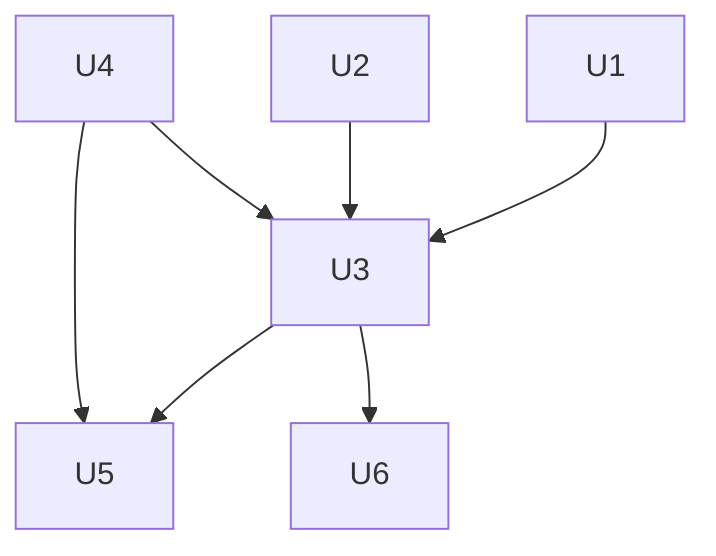

# feat: Automatyczna synchronizacja zbioru plików .cs w daemonie

## Podsumowanie

Daemon ma automatycznie wykrywać dodanie, usunięcie, zmianę nazwy i przeniesienie plików `.cs`. Nie może dawać cichych, złych odpowiedzi po refactorze, który tworzy nowe pliki. Plan realizuje podejście **A z fallbackiem do B** z dokumentu źródłowego (see origin: `docs/brainstorms/2026-11-15-daemon-file-set-auto-sync-requirements.md`):

- Jeden **wsadowy reconciler** porównuje stan dysku ze stanem solucji w pamięci. Ten sam mechanizm obsługuje zmianę treści, dodanie i usunięcie dokumentu. Wynik zastosowanej serii (`Applied`) daemon zapisuje jednym przypisaniem `_solution`. Przy fallbacku `_solution` nie zmienia się.
- Gdy nie można pewnie ustalić projektu właściciela, daemon wykonuje pełny reload (R5).
- Błąd lub przepełnienie bufora watchera powoduje pełny reload (R7).
- Lista plików metadanych zawiera też `.slnx` i `Directory.Packages.props` (R8).

---

## Opis problemu

Watcher `*.cs` w `src/AICraftDaemon/Daemon/DaemonServer.cs` (`StartFileWatcher` → `ApplyFileChangeAsync`) aktualizuje tylko dokumenty, które już są w solucji. Gdy dokumentu nie ma, kod robi `if (docIds.IsEmpty) return;`. Watcher nie obsługuje zdarzeń `Deleted` ani `Renamed`. W projektach SDK-style plik `.csproj` się nie zmienia, więc watcher metadanych też nie reaguje. Skutek: `refs`, `symbols`, `unused` i `diagnostics` zwracają fałszywe wyniki bez żadnego błędu.

Potwierdzenia z kodu (dotyczą założenia 6 z dokumentu źródłowego):
- `IsMetadataReloadCandidate` nie zawiera `.slnx` ani `Directory.Packages.props`. `.slnx` jest obsługiwany tylko w `WorkspaceLoader.LoadAsync` i w `SolutionPathResolver`, a nie w watcherze. **Luka jest potwierdzona.**
- `TriggerMetadataReloadAsync` używa `_metadataReloadSingleFlight.WaitAsync(0)`. Gdy reload już trwa, kod **odrzuca** następne żądanie. Zmiana, która przyjdzie w trakcie reloadu, może zostać utracona. To jest w konflikcie z założeniem 5 (poprawność ma priorytet) i z R7.
- `HandleRenameAsync` wywołuje `_workspace.TryApplyChanges(appliedSolution)`, a `appliedSolution` pochodzi z `_solution` (stan w pamięci). Gdy `_solution` zawiera dokumenty dodane tylko w pamięci, `TryApplyChanges` zastosuje też te różnice. MSBuildWorkspace może wtedy zapisać pliki lub zmienić `.csproj` (`ApplyDocumentAdded`/`ApplyDocumentRemoved`). Zobacz U4.

---

## Śledzenie wymagań (źródło → plan)

| Wymaganie | Gdzie w planie |
|---|---|
| R1 Dodanie pliku | U2 (reconciler: dodanie), U3 (zdarzenia `Created`/`Changed`), U5 |
| R2 Usunięcie pliku | U2 (usunięcie), U3 (`Deleted`), U5 |
| R3 Zmiana nazwy i przeniesienie | U3 (`Renamed` → dwie ścieżki; zdarzenia katalogów), U2, U5 |
| R4 Seria zmian, stan spójny | U3 (kolejka wsadowa), U2 (jedno przypisanie `_solution`) |
| R5 Fallback do pełnego reloadu | U2 (`ProjectOwnershipResolver`), U1 (niezawodny reload), założenie A5 |
| R6 Pliki pomijane | U2/U3 (filtr artefaktów, uzgadnianie wg stanu końcowego) |
| R7 Zgubione zdarzenia | U1 (`Error` watchera → reload), U3 (próg masowych zmian) |
| R8 Kompletność listy metadanych | U1 |
| R9 Dokumentacja | U6 |
| R10 Logi | U2, U3, U1 |
| Kryteria sukcesu (< ~1 s, brak fałszywych `unused`/`diagnostics`, testy integracyjne) | U5 |

---

## Zakres

### W zakresie
- Synchronizacja zbioru plików `*.cs` w katalogu solucji (dodanie, usunięcie, rename, przeniesienie pliku lub katalogu).
- Pełny reload jako fallback i przy utracie zdarzeń.
- Rozszerzenie listy plików metadanych (`.slnx`, `Directory.Packages.props`).
- Zabezpieczenie ścieżki `rename` przed rozjazdem między solucją w pamięci a `MSBuildWorkspace` (pełny reload przed `rename`, gdy zbiór dokumentów w pamięci różni się od stanu `MSBuildWorkspace`).

### Poza zakresem (z dokumentu źródłowego)
- Pliki inne niż `.cs` (`.vb`, `.fs`, `.razor`, `.cshtml`, `.xaml`).
- Pełna ewaluacja reguł MSBuild (`Compile Include/Remove`, warunki). Przypadki niepewne obsługuje fallback (R5).
- Zmiany w zewnętrznych referencjach (NuGet restore, nowe DLL) poza R8.

### Odłożone do dalszej pracy
- Przeładowanie solucji „w tle” z obsługą zapytań na starym snapshotcie do zakończenia reloadu (zobacz pytanie P1).
- Leniwe sprawdzenie przy zapytaniu (podejście C) jako stała siatka bezpieczeństwa. Plan używa tylko reakcji na zdarzenie `Error` (R7).

---

## Kluczowe decyzje techniczne

1. **Jeden reconciler dla treści i zbioru plików.** Wszystkie zdarzenia `*.cs` (`Created`, `Changed`, `Deleted`, `Renamed`) trafiają do jednej kolejki ścieżek. Po debounce reconciler sprawdza **stan końcowy** każdej ścieżki:
   - plik jest na dysku i w solucji → aktualizacja treści **wszystkich** `DocumentId` z `GetDocumentIdsWithFilePath` (multi-target; obecny kod aktualizuje tylko `docIds.First()`), z ochroną przed pustym odczytem;
   - plik jest na dysku, nie ma go w solucji → dodanie (wg reguł właściciela);
   - pliku nie ma na dysku, jest w solucji → usunięcie ze wszystkich projektów (`GetDocumentIdsWithFilePath`);
   - pliku nie ma na dysku ani w solucji → brak akcji.
   Tekst dokumentu kod tworzy ze strumienia pliku (`SourceText.From(Stream)`), aby wykryć BOM i kodowanie. Kod nie wymusza `Encoding.UTF8` (to dodałoby BOM przy zapisie w U4).
   Uzasadnienie: uzgadnianie wg stanu końcowego jest idempotentne. Dzięki temu zapis atomowy (plik tymczasowy + rename), pary `Created`+`Changed`, zdarzenia w dowolnej kolejności i zdarzenia w trakcie reloadu dają poprawny wynik (R6). Obecny debounce dla każdej ścieżki osobno daemon zastępuje jednym debounce dla całej serii.
2. **Jedno przypisanie `_solution` na serię (R4).** Reconciler buduje nową `Solution` z bieżącej pod `_solutionLock` i przypisuje ją jeden raz. Handlery zapytań pobierają `GetSolution()` raz na zapytanie, więc zawsze widzą stary albo nowy snapshot, nigdy stan mieszany.
3. **Debounce z limitem.** Debounce kończący (ok. 400 ms, jak obecnie) z maksymalnym opóźnieniem (ok. 2 s). Ciągły strumień zdarzeń nie może opóźniać aktualizacji bez końca. Dokładne wartości ustala implementacja.
4. **Reguły właściciela (R5, założenia 1–2 z dokumentu źródłowego):**
   - kandydaci = różne pliki `.csproj` z solucji, których katalog jest przodkiem pliku (porównanie ścieżek wg reguły OS jak w `IsBuildArtifactPath`);
   - 0 kandydatów → gdy wszystkie projekty solucji mają „bezpieczną politykę Compile”, plik jest poza solucją i daemon go ignoruje (bez reloadu, wpis w logu). Gdy którykolwiek projekt jej nie ma (np. `<Compile Include="..\Shared\**\*.cs" />`), daemon wykonuje fallback, bo plik może należeć do tego projektu (zobacz pytanie P5);
   - więcej niż 1 kandydat (projekty zagnieżdżone) → fallback (zobacz pytanie P2);
   - 1 kandydat → dodanie do **wszystkich** instancji `Project` z tym `FilePath` (multi-targeting daje osobny projekt dla każdego TFM), pod warunkiem że projekt ma „bezpieczną politykę Compile”;
   - „bezpieczna polityka Compile” = plik projektu jest SDK-style (atrybut `Sdk`, element `<Sdk>` lub `Import Sdk=`) i ani projekt, ani pliki `Directory.Build.props/targets` (szukane w górę od katalogu projektu do korzenia systemu plików, tak jak robi to MSBuild) nie zawierają jawnych elementów `Compile` (`Include`/`Remove`/`Update`) ani właściwości `EnableDefaultCompileItems`, `EnableDefaultItems`, `DefaultItemExcludes`, `DefaultExcludesInProjectFolder`. Gdy warunek nie jest spełniony → fallback. To jest heurystyka tekstowa/XML, nie ewaluacja MSBuild (poza zakresem). Resolver czyta pliki przy każdej serii z dodaniem pliku (bez cache: koszt jest mały, a cache mógłby dać stary wynik);
   - plik w ścieżce z segmentem, który zaczyna się od `.` (ukryty katalog), lub w `obj/`, `bin/` → ignorowany, tak jak w domyślnych wykluczeniach SDK.
5. **Fallback w serii.** Gdy jedna ścieżka w serii wymaga fallbacku, daemon odrzuca całą serię i planuje pełny reload (pełny reload i tak odczyta dysk). Ten sam wynik daje seria, w której liczba ścieżek **zmieniających zbiór plików** (dodanie lub usunięcie dokumentu; zmiany treści się nie liczą) jest większa niż próg masowych zmian (np. `git checkout`). Dzięki temu `dotnet format` na setkach plików nie powoduje reloadu. Wartość progu ustala implementacja, rząd wielkości: kilkaset ścieżek.
6. **Zdarzenia katalogów (R3).** Watcher `*.cs` nie widzi zmiany nazwy ani usunięcia katalogu. Watcher bez filtra (obecny watcher metadanych) dostaje `NotifyFilters.DirectoryName` (bez tej flagi nie zgłasza zdarzeń katalogów). Dla `Deleted`/`Renamed`/`Created` ścieżki, która nie jest plikiem metadanych ani artefaktem (`obj/`, `bin/`, `.git/`, ukryte katalogi), watcher dodaje do kolejki **znacznik katalogu** (starą i nową ścieżkę). Reconciler rozwija znacznik w chwili opróżnienia serii: dokumenty solucji pod prefiksem plus pliki `*.cs` na dysku pod prefiksem. Uzasadnienie: na Linux watcher dodaje obserwację nowego katalogu dopiero po zdarzeniu `Created`, więc plik zapisany od razu po `mkdir` może nie dać zdarzenia. Rozwinięcie wg stanu końcowego dysku go znajdzie. Daemon nie robi pełnego reloadu przy przeniesieniu katalogu (zobacz pytanie P4).
7. **Pełny reload zawsze idzie przez `StartBackgroundLoad`.** Watcher metadanych, fallback reconcilera i `Error` watchera używają tej samej ścieżki co `server reload` (łańcuch zadań, poprzedzony debounce). Kod usuwa `_metadataReloadSingleFlight`, więc daemon nie gubi żądania w trakcie reloadu.
8. **`rename` zachowuje `TryApplyChanges`, ale nie działa na rozjechanym zbiorze dokumentów (U4).** Decyzja użytkownika (Q3, opcja 2). Pod `_solutionLock` `rename` (bez `--dry-run`) porównuje zbiór dokumentów `_solution` (po `FilePath` i projekcie) ze zbiorem w `_workspace.CurrentSolution`. Gdy zbiory się różnią (dokument dodany lub usunięty w pamięci), `rename` nie zapisuje nic na dysk: planuje pełny reload przez `StartBackgroundLoad` i zwraca `SOLUTION_LOADING`. Agent powtarza `rename` po reloadzie. Gdy zbiory są równe, `TryApplyChanges` działa jak dotąd, bez ryzyka zmiany `.csproj`. Kod pobiera `_solution`, rozwiązuje symbol i wykonuje `Renamer` **pod** `_solutionLock`, aby przypisanie nie cofnęło serii reconcilera zastosowaną w międzyczasie.
9. **Nowe klasy poza `DaemonServer.cs`.** `DaemonServer.cs` ma ok. 2400 linii. Logikę uzgadniania i reguł właściciela kod umieszcza w osobnym folderze `src/AICraftDaemon/Daemon/FileSetSync/`. Te klasy można testować bez gniazda i bez watcherów.

## Założenia (Q1, Q2, Q4, Q5: rekomendacje potwierdzone przez użytkownika; Q3: opcja 2 wybrana przez użytkownika)

- A1. Podczas pełnego reloadu (fallback, R7, R8) zapytania dostają `SOLUTION_LOADING`, tak jak teraz przy zmianie `.csproj`. Plan uznaje to za zgodne z R4 (brak stanu mieszanego). (P1)
- A2. Projekty zagnieżdżone (katalog projektu wewnątrz katalogu innego projektu) → fallback, a nie „najbliższy przodek”. To zawęża założenie 2 z dokumentu źródłowego na rzecz założenia 5 (poprawność ma priorytet), bo domyślny glob zewnętrznego projektu SDK też obejmuje pliki projektu wewnętrznego. (P2)
- A3. (Q3, opcja 2) `rename` zostaje przy `TryApplyChanges`. Gdy zbiór dokumentów w pamięci różni się od `MSBuildWorkspace`, `rename` robi najpierw pełny reload i zwraca `SOLUTION_LOADING`. (P3)
- A4. Przeniesienie lub zmiana nazwy katalogu jest obsługiwana przyrostowo (rozwinięcie znacznika katalogu), a nie pełnym reloadem. (P4)
- A5. Plik bez projektu nadrzędnego jest ignorowany, gdy wszystkie projekty mają bezpieczną politykę Compile; w przeciwnym razie → fallback. To łączy R5 („brak projektu nadrzędnego” → fallback) z założeniem 2 z dokumentu źródłowego („ignoruje, bez reloadu”). (P5)

---

## Projekt techniczny wysokiego poziomu

> To jest kierunek do przeglądu, nie specyfikacja implementacji. Implementujący traktuje to jako kontekst, a nie kod do skopiowania.

```mermaid
flowchart LR
  W1["FileSystemWatcher *.cs<br/>Created/Changed/Deleted/Renamed"] --> Q
  W2["FileSystemWatcher (bez filtra)<br/>katalogi + metadane"] -->|katalog| X["rozwinięcie do ścieżek .cs"] --> Q
  W2 -->|metadane .sln/.slnx/.csproj/...props| R
  W1 -->|Error| R
  W2 -->|Error| R
  Q["FileSetChangeQueue<br/>debounce ~400 ms, max ~2 s"] --> C{"SolutionFileSetReconciler<br/>(pod _solutionLock)"}
  C -->|Applied: nowa Solution| S["_solution = nowa (1 przypisanie)"]
  C -->|Fallback(powód) / próg| R["ScheduleFullReload(powód)<br/>debounce → StartBackgroundLoad"]
```

Wynik reconcilera (szkic): `Applied(newSolution, added[], removed[], updated[])` | `NoChange` | `Fallback(reason)`.

---

## Jednostki implementacji



### U1. Niezawodny pełny reload i kompletna lista metadanych

**Cel:** Wszystkie wyzwalacze pełnego reloadu (zmiana metadanych, fallback, błąd watchera) idą jedną ścieżką i nie gubią żądań. Lista metadanych zawiera `.slnx` i `Directory.Packages.props`.

**Wymagania:** R7, R8, R10, R5 (zależność: fallback musi być niezawodny)

**Zależności:** brak

**Pliki:**
- Modyfikacja: `src/AICraftDaemon/Daemon/DaemonServer.cs` (`IsMetadataReloadCandidate`, `ScheduleMetadataReload` → `ScheduleFullReload(reason)`, `TriggerMetadataReloadAsync`, `StartMetadataWatcher`, `StartFileWatcher`)
- Test: `tests/DotnetAICraft.Tests/Daemon/MetadataReloadCandidateTests.cs`
- Test: `tests/DotnetAICraft.Tests/Daemon/DaemonReloadTests.cs` (rozszerzenie)

**Podejście:**
- Dodać `.slnx` i `Directory.Packages.props` do `IsMetadataReloadCandidate`. Zmienić metodę z `private` na `internal` (testy mają `InternalsVisibleTo`).
- Zmienić nazwę `ScheduleMetadataReload` na `ScheduleFullReload(string reason)`. Po debounce metoda wywołuje `StartBackgroundLoad()` zamiast `TriggerMetadataReloadAsync`. Usunąć `_metadataReloadSingleFlight`. Zapisać w logu `Full reload scheduled: <reason>`.
- Podłączyć `Error` obu watcherów do handlera, który: zapisuje błąd w logu; gdy watcher jest zatrzymany (`EnableRaisingEvents == false` lub błąd inny niż przepełnienie bufora) zwalnia i tworzy watcher ponownie; potem wywołuje `ScheduleFullReload("watcher error: …")`. Bez ponownego utworzenia daemon po jednym reloadzie zostałby bez watchera (R7).
- Zwiększyć `InternalBufferSize` (np. 64 KB). To działa tylko na Windows; na Linux limit ustawia `fs.inotify.max_queued_events`.
- Watcher bez filtra odrzuca ścieżki `obj/`, `bin/`, `.git/` przed jakąkolwiek pracą, aby build i `git` nie dawały pracy ani reloadów.
- Obsłużyć `Deleted` w watcherze metadanych (usunięcie `.csproj`/`.slnx` też wymaga reloadu). Obecnie kod obsługuje tylko `Changed`/`Created`/`Renamed`.

**Wzorce:** `HandleReload` + `StartBackgroundLoad` (łańcuch ładowań, `Loading` ustawiane synchronicznie).

**Scenariusze testowe:**
- `IsMetadataReloadCandidate`: `App.slnx`, `Directory.Packages.props`, `directory.packages.props` (wielkość liter) → true; `Foo.cs`, `Directory.Packages.props.bak`, `null`, pusty → false; istniejące wartości (`.sln`, `.csproj`, `Directory.Build.props`) dalej → true.
- Dwa wywołania `ScheduleFullReload` w odstępie krótszym niż debounce → jedno ładowanie.
- Wywołanie `ScheduleFullReload` w trakcie trwającego ładowania → po jego zakończeniu daemon wykona drugie ładowanie (regresja dla usuniętego `WaitAsync(0)`). Weryfikacja przez licznik prób ładowania lub `LastLoadAttemptAt` na nieistniejącej solucji, jak w `DaemonReloadTests`.
- Zdarzenie `Error` watchera → status przechodzi w `loading` (wyzwalacz wywołany przez hook testowy lub bezpośrednio przez metodę `internal`).
- Zdarzenie `Error` dla zatrzymanego watchera → kod tworzy nowy watcher; następna zmiana pliku `.cs` jest wykryta.

**Weryfikacja:** zmiana `.slnx` lub `Directory.Packages.props` w działającym daemonie powoduje reload. Żaden wyzwalacz w trakcie reloadu nie zostaje utracony.

### U2. Reconciler zbioru plików i reguły właściciela

**Cel:** Czysta logika: na podstawie bieżącej `Solution` i zbioru ścieżek reconciler zwraca nową `Solution`, „brak zmian” albo „fallback (powód)”.

**Wymagania:** R1, R2, R3, R4, R5, R6, R10

**Zależności:** brak

**Pliki:**
- Nowy: `src/AICraftDaemon/Daemon/FileSetSync/SolutionFileSetReconciler.cs`
- Nowy: `src/AICraftDaemon/Daemon/FileSetSync/ProjectOwnershipResolver.cs`
- Modyfikacja: `src/AICraftDaemon/Daemon/DaemonServer.cs` (przeniesienie `IsBuildArtifactPath` do miejsca współdzielonego albo zmiana na `internal static`)
- Test: `tests/DotnetAICraft.Tests/Daemon/FileSetSync/SolutionFileSetReconcilerTests.cs`
- Test: `tests/DotnetAICraft.Tests/Daemon/FileSetSync/ProjectOwnershipResolverTests.cs`

**Podejście:**
- Reconciler realizuje decyzje 1, 2, 4 i 5 z sekcji „Kluczowe decyzje techniczne”. Dodanie: `Solution.AddDocument(DocumentId.CreateNewId(projectId), name, text, folders, filePath)` dla każdej instancji projektu (multi-target). `folders` = ścieżka względna od katalogu projektu. Kod robi zmiany tylko w pamięci, tak jak obecne `WithDocumentText` (bez `TryApplyChanges`).
- Aktualizacja treści: wszystkie `DocumentId` dla ścieżki (multi-target). Zachować ochronę przed pustym odczytem. Pominąć aktualizację, gdy tekst się nie zmienił (np. po zapisie przez `rename`). Tekst czytać ze strumienia (wykrycie BOM/kodowania).
- Kolejność w serii: najpierw usunięcia, potem dodania; ścieżki porównywać dokładnie (`Document.FilePath`, ordinal na Linux). To chroni rename różniący się tylko wielkością liter.
- Filtr artefaktów i ukrytych katalogów działa też w reconcilerze (także dla ścieżek z rozwinięcia katalogu). Usunięcie `obj/` (np. `git clean -xdf`) nie może usunąć dokumentów generowanych, np. `GlobalUsings.g.cs`.
- Rozwinięcie znaczników katalogów (decyzja 6) jest w reconcilerze, w chwili opróżnienia serii.
- Błąd I/O przy odczycie (plik zablokowany) → ścieżka wraca do kolejki raz. Przy kolejnym błędzie → wpis w logu i pominięcie (obecne zachowanie: `File update error`).
- `ProjectOwnershipResolver`: reguły z decyzji 4, bez cache.
- Reconciler zwraca listy `added`/`removed`/`updated` i powód fallbacku. `DaemonServer` zapisuje je w logu (`Added: <plik> → <projekt>`, `Removed: <plik>`, `Updated: <plik>`, `Fallback: <powód>`).

**Execution note:** Logikę reconcilera i resolvera implementować metodą test-first. Testy są szybkie i nie wymagają MSBuild (`AdhocWorkspace` + tymczasowy katalog z plikiem `.csproj` na dysku).

**Wzorce:** `IsBuildArtifactPath` (porównanie ścieżek zależne od OS). Testy z `AdhocWorkspace` w `tests/DotnetAICraft.Tests/Daemon/DefinitionResolutionTests.cs`.

**Scenariusze testowe:**
- Happy path: nowy `Foo.cs` w katalogu projektu SDK → `Applied`, dokument jest w projekcie, `Compilation` zawiera typ `Foo`. (Covers R1)
- Happy path: usunięty plik będący w solucji → `Applied`, dokumentu nie ma w żadnym projekcie. (R2)
- Rename w jednej serii: stara ścieżka nie istnieje, nowa istnieje → usunięcie + dodanie, jedno `Applied`. (R3)
- Przeniesienie między projektami A → B → dokument jest tylko w B. (R3)
- Multi-target: dwa `Project` z tym samym `FilePath` → dokument dodany do obu.
- Plik poza katalogami projektów → `NoChange` (ignorowany, bez fallbacku).
- Projekty zagnieżdżone (`src/A/A.csproj` i `src/A/Sub/Sub.csproj`, plik w `Sub`) → `Fallback("overlapping projects")`. (R5, A2)
- Projekt legacy (bez `Sdk`) → `Fallback`. Projekt z `<Compile Remove="…">` → `Fallback`. `Directory.Build.props` z `EnableDefaultCompileItems` → `Fallback`. (R5)
- Właściciel jest projektem `.vbproj`/`.fsproj` → ignorowany.
- Plik w `obj/`, `bin/`, `*.g.cs`, `*.g.i.cs`, w ukrytym katalogu (`.foo/`) → ignorowany. (R6)
- Znacznik usuniętego katalogu `obj/` → dokumenty generowane z `obj/` zostają w solucji.
- Projekt z `<DefaultItemExcludes>` (w projekcie lub w `Directory.Build.props` powyżej katalogu solucji) → `Fallback`. (R5)
- Projekt A z `<Compile Include="..\Shared\*.cs" />` i nowy plik w `Shared` (0 kandydatów) → `Fallback`. Ten sam plik, gdy wszystkie projekty mają bezpieczną politykę → `NoChange`. (R5, A5)
- Multi-target: zmiana treści pliku → nowy tekst we wszystkich instancjach projektu.
- Plik bez BOM → `SourceText` bez BOM; plik z BOM → z BOM.
- Znacznik katalogu: katalog przeniesiony w projekcie → usunięcie starych ścieżek, dodanie nowych, jedno `Applied`. Nowy katalog z plikiem, dla którego nie było zdarzenia pliku → plik dodany.
- Plik tymczasowy, który powstał i zniknął w jednej serii → `NoChange`. (R6)
- Ścieżka jest na dysku i w solucji, tekst bez zmian → `NoChange`. Pusty odczyt istniejącego dokumentu → brak aktualizacji.
- Seria z jedną ścieżką fallback i innymi poprawnymi → cała seria `Fallback`, `_solution` bez zmian. (R4/R5)
- Rename różniący się tylko wielkością liter (`Foo.cs` → `foo.cs`) na Linux, Windows i macOS → jeden dokument z nową ścieżką.

**Weryfikacja:** wszystkie testy jednostkowe przechodzą. Reconciler nie ma zależności od `FileSystemWatcher` ani od gniazda.

### U3. Kolejka zdarzeń i podłączenie watcherów

**Cel:** Zastąpić debounce dla każdej ścieżki jedną kolejką wsadową. Obsłużyć `Deleted`, `Renamed` i zdarzenia katalogów. Zapisać wynik reconcilera jednym przypisaniem.

**Wymagania:** R1–R4, R6, R7, R10

**Zależności:** U1, U2, U4 (U4 musi być wydana razem z U3 lub wcześniej)

**Pliki:**
- Nowy: `src/AICraftDaemon/Daemon/FileSetSync/FileSetChangeQueue.cs`
- Modyfikacja: `src/AICraftDaemon/Daemon/DaemonServer.cs` (`StartFileWatcher`, `StartMetadataWatcher`, zastąpienie `ApplyFileChangeAsync` metodą `ApplyFileSetBatchAsync`)
- Test: `tests/DotnetAICraft.Tests/Daemon/FileSetSync/FileSetChangeQueueTests.cs`

**Podejście:**
- `FileSetChangeQueue`: zbiór ścieżek bez duplikatów, debounce kończący z maksymalnym opóźnieniem (decyzja 3), próg masowych zmian (decyzja 5). Wstrzykiwany `TimeProvider` lub opóźnienie, aby testy były deterministyczne. Jedno opróżnianie kolejki w danej chwili. Ścieżki, które przyjdą w trakcie opróżniania, trafiają do następnej serii.
- Watcher `*.cs`: `Created`/`Changed`/`Deleted` → `Enqueue(FullPath)`. `Renamed` → `Enqueue(OldFullPath)` i `Enqueue(FullPath)`, gdy którakolwiek ma rozszerzenie `.cs`. Filtr artefaktów przed dodaniem do kolejki.
- Watcher bez filtra: dodać `NotifyFilters.DirectoryName`. Zdarzenia `Created`/`Changed`/`Renamed` plików `.cs` → `Enqueue(FullPath)` (i `OldFullPath`), aby pokryć np. `Foo.tmp` → `Foo.cs`. Zdarzenia katalogów (ścieżka bez rozszerzenia `.cs`, nie metadane, nie artefakt) → `EnqueueDirectory(old, new)` (decyzja 6). Kolejka zbiera znaczniki; rozwija je reconciler.
- `ApplyFileSetBatchAsync`: pod `_solutionLock` wywołuje reconciler. Gdy solucja nie jest załadowana (`Loading`/`Unloaded`) → kod pomija serię. To jest bezpieczne: `TryLoadSolutionAsync` trzyma `_solutionLock` przez cały load, a stan `Loading` widoczny pod blokadą oznacza ładowanie w łańcuchu, które dopiero odczyta dysk. `Applied` → jedno przypisanie `_solution` i logi. `Fallback` → `ScheduleFullReload(reason)`.
- Zachować obecne opóźnienie ok. 400 ms dla zmiany treści (kryterium sukcesu < ~1 s).

**Wzorce:** obecny debounce w `ScheduleMetadataReload` (CTS + `Task.Delay`). Wzorzec „accept-then-load” w `StartBackgroundLoad`.

**Scenariusze testowe:**
- Wiele `Enqueue` w oknie debounce → jedno opróżnienie z wszystkimi ścieżkami (bez duplikatów). (R4)
- Ciągły strumień zdarzeń dłuższy niż maksymalne opóźnienie → opróżnienie najpóźniej po maksymalnym opóźnieniu.
- Liczba ścieżek zmieniających zbiór plików powyżej progu → `Fallback`/pełny reload. Ta sama liczba zmian samej treści → `Applied` bez reloadu.
- `Enqueue` w trakcie opróżniania → ścieżka trafia do następnej serii, nie zostaje utracona.
- Dispose kolejki → brak opróżnienia po zamknięciu daemona.

**Weryfikacja:** testy kolejki przechodzą. Scenariusze end-to-end pokrywa U5.

### U4. `rename` po zmianie zbioru plików: pełny reload zamiast `TryApplyChanges` na rozjechanym stanie

**Cel:** Po dodaniu lub usunięciu dokumentów w pamięci `rename` nie może zmienić `.csproj` ani zapisać na dysk plików spoza wyniku `Renamer`.

**Wymagania:** założenie 4 z dokumentu źródłowego (zachowanie `rename` bez zmian), założenie 5

**Zależności:** brak. U3 zależy od U4 (U4 jest wymagana przed wydaniem U3).

**Pliki:**
- Modyfikacja: `src/AICraftDaemon/Daemon/DaemonServer.cs` (`HandleRenameAsync`)
- Test: `tests/DotnetAICraft.Tests/Daemon/DaemonRenameApplyTests.cs` (nowy)

**Podejście:**
- Pod `_solutionLock`: ponownie odczytać `_solution`. Rozwiązać symbol i wykonać `Renamer.RenameSymbolAsync` na tym snapshotcie. `UseCase.ResolveAsync` (podgląd/walidacja) może zostać poza blokadą.
- Dla `rename` bez `--dry-run`, przed `TryApplyChanges`: porównać zbiór dokumentów `_solution` ze zbiorem `_workspace.CurrentSolution` (klucz: projekt + `FilePath`). Gdy się różnią → nie zapisywać nic, wywołać `ScheduleFullReload("rename: in-memory document set differs")` i zwrócić `SOLUTION_LOADING`. Gdy są równe → `TryApplyChanges` jak dotąd, potem `_solution = appliedSolution` pod tą samą blokadą.
- `--dry-run` nie wymaga porównania (nie zapisuje).
- Zanotować w kodzie, że `_workspace.CurrentSolution` nie jest źródłem prawdy po aktualizacjach w pamięci.

**Scenariusze testowe:**
- Solucja z dokumentem dodanym w pamięci + `rename` symbolu → `SOLUTION_LOADING`, plik na dysku bez zmian, `.csproj` bez zmian, uruchomiony pełny reload. Po reloadzie powtórzony `rename` daje poprawny wynik.
- Solucja bez różnic zbioru dokumentów (tylko zmiany treści) → `rename` działa jak dotąd.
- `rename --dry-run` przy rozjechanym zbiorze → wynik podglądu, brak zapisu i brak reloadu.
- Seria reconcilera dodaje dokument między `ResolveAsync` a pobraniem blokady przez `rename` → `rename` widzi różnicę i robi reload (nie cofa serii).

**Weryfikacja:** `rename` po dodaniu pliku nie zmienia plików projektu i nie gubi dokumentów.

---

### U5. Testy integracyjne na prawdziwej solucji

**Cel:** Spełnić kryterium sukcesu: testy integracyjne dla dodania, usunięcia, rename, przeniesienia między projektami, serii plików i fallbacku.

**Wymagania:** R1–R7, kryteria sukcesu

**Zależności:** U3, U4

**Pliki:**
- Modyfikacja: `src/AICraftDaemon/Daemon/DaemonServer.cs` (wydzielenie z `RunAsync` metody `internal`, która ładuje solucję i uruchamia watchery bez gniazda — do użycia w testach)
- Test: `tests/DotnetAICraft.Tests/Daemon/DaemonFileSetSyncIntegrationTests.cs`

**Podejście:**
- Każdy test kopiuje `tests/fixtures/SampleSolution` do katalogu tymczasowego, ładuje go przez MSBuild (rejestracja `MSBuildLocator` jak w `SampleSolutionFixtureTests`) i uruchamia watchery. Zapytania idą przez `DispatchAsync` (`symbols`, `refs`, `diagnostics`, `unused`).
- Oczekiwanie na wynik: odpytywanie z limitem czasu (np. 5 s), nie stały `sleep`. Zdarzenia `FileSystemWatcher` przychodzą asynchronicznie.
- Testy oznaczyć cechą (`Trait`), aby można je było wyłączyć w środowisku bez MSBuild lub z zawodnym watcherem (np. dyski sieciowe).

**Scenariusze testowe:**
- Wydzielenie klasy do nowego pliku w `Sample.Domain` → `symbols --pattern NewClass*` zwraca klasę; `diagnostics --severity error` nie zgłasza brakującego typu; czas < ~1 s po zapisie (pomiar informacyjny, z luźnym progiem w CI). (R1, kryterium sukcesu)
- Usunięcie pliku → `symbols` nie zwraca typu; `refs` nie zwraca lokalizacji z tego pliku. (R2)
- Rename pliku w tym samym katalogu → jeden dokument z nową ścieżką. (R3)
- Przeniesienie pliku z `Sample.Domain` do `Sample.Infrastructure` → dokument jest tylko w nowym projekcie. (R3)
- Przeniesienie katalogu z plikami `.cs` wewnątrz projektu → wszystkie dokumenty mają nowe ścieżki, bez pełnego reloadu. (R3, decyzja 6)
- `mkdir` nowego katalogu i od razu zapis pliku `.cs` w nim → dokument jest widoczny. (R1, decyzja 6)
- Utworzenie 20 plików w jednej serii → wszystkie widoczne. Zapytanie w trakcie nie zwraca stanu częściowego (sprawdzić, że liczba dokumentów to stara albo nowa wartość). (R4)
- Plik w katalogu poza projektami → brak zmiany i brak reloadu. Plik w projekcie z `<Compile Remove>` → status przechodzi w `loading`, potem `loaded`, plik jest widoczny wg reguł MSBuild. (R5)
- Plik w `obj/` → brak zmiany. (R6)
- `unused` po dodaniu pliku, który używa wcześniej „nieużywanego” symbolu → symbol nie jest zgłaszany. (kryterium sukcesu)

**Weryfikacja:** wszystkie scenariusze przechodzą lokalnie na Linux i Windows (gdy CI ma Windows).

### U6. Dokumentacja i changelog

**Cel:** Dokumentacja mówi, że dodanie, usunięcie i zmiana nazwy plików są wykrywane automatycznie. `server reload` zostaje jako narzędzie awaryjne.

**Wymagania:** R9

**Zależności:** U3

**Pliki:**
- Modyfikacja: `plugins/dotnet-aicraft/skills/dotnet-aicraft/SKILL.md` (sekcja „Keeping the daemon in sync”)
- Modyfikacja: `plugins/dotnet-aicraft/skills/dotnet-aicraft/references/commands/server.md` (sekcja `server reload`)
- Modyfikacja: `CHANGELOG.md`

**Podejście:** Krótki tekst (SKILL.md ma ograniczony budżet tokenów, zobacz `docs/plans/skill-token-footprint-optimization.md`). Treść: edycje oraz dodanie/usunięcie/rename plików `.cs` są wykrywane automatycznie; zmiany projektów i solucji (`.sln`, `.slnx`, `.csproj`, `Directory.*.props`) powodują automatyczny reload; `rename` zaraz po dodaniu lub usunięciu pliku może zwrócić `SOLUTION_LOADING`: powtórzyć po reloadzie; `server reload` używać, gdy wynik jest podejrzany (np. dysk sieciowy, WSL2 z plikami na `/mnt`).

**Test expectation:** none -- tylko dokumentacja.

**Weryfikacja:** tekst w obu plikach jest zgodny z zachowaniem z U1–U3.

---

## Wpływ na system

- **Agenci i użytkownicy CLI:** brak zmian kontraktu poleceń. Mniej przypadków cichych, złych odpowiedzi. Więcej pełnych reloadów w projektach legacy lub zagnieżdżonych (okno `SOLUTION_LOADING`).
- **Wydajność:** zdarzenia `*.cs` są już przetwarzane. Nowy koszt to rozwinięcie znaczników katalogów i odczyt XML plików projektu przy dodaniu pliku. Oczekiwany koszt jest mały, ale nie jest zmierzony; sprawdzić ręcznie na dużej solucji.
- **Współbieżność:** reconciler, reload i `rename` są serializowane przez `_solutionLock` (po U4 `rename` pobiera snapshot pod blokadą).
- **`rename`:** po zmianie zbioru plików pierwszy `rename` może zwrócić `SOLUTION_LOADING` (zmiana widoczna dla użytkownika, wybór Q3). Pełny reload jest łańcuchem przez `StartBackgroundLoad`.
- **Idle shutdown:** reload przez `StartBackgroundLoad` resetuje termin bezczynności (`ResetIdleDeadline` w `TryLoadSolutionAsync`), tak jak teraz.

## Ryzyka

| Ryzyko | Ograniczenie |
|---|---|
| Heurystyka polityki Compile nie wykryje reguły (np. warunek w importowanym `.targets`) | Konserwatywne reguły; `server reload` zostaje w dokumentacji; projekty spoza heurystyki → fallback |
| `FileSystemWatcher` gubi zdarzenia (WSL2 `/mnt`, dyski sieciowe) bez zdarzenia `Error` | Poza zakresem (podejście C odłożone); dokumentacja wskazuje `server reload` |
| Testy integracyjne z watcherem są niestabilne w CI | Odpytywanie z limitem czasu, `Trait` do wyłączenia, logika w testach jednostkowych bez watchera (U2, U3) |
| Zachowanie `MSBuildWorkspace.TryApplyChanges` przy dokumentach dodanych w pamięci nie jest potwierdzone empirycznie | U4: przy rozjeździe zbioru dokumentów `rename` robi pełny reload i nie wywołuje `TryApplyChanges` |
| `rename` tuż po dodaniu pliku zwraca `SOLUTION_LOADING` (wolniej) | Akceptowane w Q3; agent powtarza polecenie po reloadzie; udokumentować w U6 |
| Wiele pełnych reloadów pod rząd (np. `git checkout` z wieloma `.csproj` i wieloma plikami `.cs` — reload z metadanych i reload z progu) | Debounce przed `StartBackgroundLoad`; dwa reloady są poprawne, ale podwajają okno `SOLUTION_LOADING` |
| Przepełnienie bufora watchera bez filtra podczas `dotnet build` → częste pełne reloady | Odrzucanie `obj/`, `bin/`, `.git/` przed pracą; ręczny pomiar na dużej solucji przed wydaniem |
| Testy integracyjne wymagają SDK .NET 10 (fixture `net10.0`) | Sprawdzić środowisko CI; `Trait` do wyłączenia |

## Odłożone do implementacji

- Dokładne wartości debounce, maksymalnego opóźnienia i progu masowych zmian.
- Dokładne nazwy metod i typów wyniku reconcilera.
- Czy `FileSystemWatcher` z filtrem `*.cs` na Linux zgłasza `Renamed`, gdy tylko jedna z nazw ma rozszerzenie `.cs` (np. `Foo.tmp` → `Foo.cs`). Uzgadnianie wg stanu końcowego i zdarzenie `Created`/`Changed` z drugiego watchera powinny pokryć oba warianty. Implementacja to sprawdzi i doda test.
- Jak wydzielić z `RunAsync` metodę dla testów integracyjnych (U5) bez zmiany ścieżki produkcyjnej.

---

## Decyzje użytkownika

Użytkownik odpowiedział w wątkach przeglądu: Q1 = opcja 1 (`SOLUTION_LOADING`), Q2 = opcja 1 (fallback dla projektów zagnieżdżonych), Q3 = opcja 2 (`TryApplyChanges` + pełny reload przed `rename` przy rozjeździe), Q4 = opcja 1 (obsługa przyrostowa katalogów), Q5 = opcja 1 (ignorować lub fallback wg polityki Compile). Brak otwartych pytań.

---

## Źródła

- Dokument źródłowy: `docs/brainstorms/2026-11-15-daemon-file-set-auto-sync-requirements.md`
- Kod: `src/AICraftDaemon/Daemon/DaemonServer.cs` (`StartFileWatcher`, `ApplyFileChangeAsync`, `StartMetadataWatcher`, `IsMetadataReloadCandidate`, `TriggerMetadataReloadAsync`, `StartBackgroundLoad`, `HandleRenameAsync`), `src/AICraftDaemon/Roslyn/WorkspaceLoader.cs`, `src/DotnetAICraft.Core/Commands/Shared/SolutionPathResolver.cs`
- Testy: `tests/DotnetAICraft.Tests/Daemon/DaemonReloadTests.cs`, `tests/DotnetAICraft.Tests/Fixtures/SampleSolutionFixtureTests.cs`
